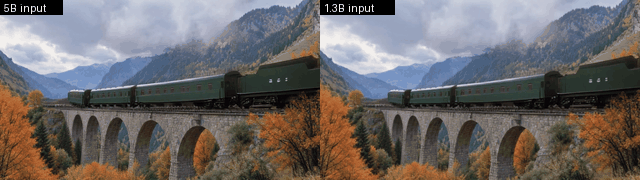

# Looking Ahead for ComfyUI

**Looking Ahead**（[論文](https://arxiv.org/abs/2610.29989)、[コード](https://github.com/TencentARC/Looking-Ahead)、
[重み](https://huggingface.co/TencentARC/Looking-Ahead)）の非公式 ComfyUI ノードです。Looking Ahead は Tencent ARC Lab・南京大学・浙江大学による
Future Chunk Prediction（FCP）の自己回帰動画モデルです。このパックは、公開されている 2 つのテキスト＋画像→動画モデル、1.3B（Wan 2.1 ベース）と
5B（Wan 2.2 TI2V ベース）を動かします。開始画像とプロンプトを与えると、公式推論と同じく KV キャッシュを使って 3 潜在フレームずつ動画を生成します。

[English README](README.md)


1.3B の 4 本とも、既定の設定（768×432、16 fps、50 ステップ）で seed 42 の 1 回目の出力を、縮小しただけでそのまま並べています。風車は回り、列車は橋を渡ります。
犬は浜辺を走りますが、くわえていたおもちゃが消えます。凧は失敗例で、上昇せずにフレームの外へ落ちていきます。開始画像はこのデモのために MOSS-Image（Apache-2.0）で
生成しました。プロンプトと詳細は [docs/images](docs/images/README.md) にあります。


同じ開始画像とプロンプトを 5B（1024×576、24 fps）で生成したもので、こちらも seed 42 の 1 回目の出力です。凧は空にとどまり、列車は橋を渡ります。
風車の羽根は一部のフレームでにじみ、犬はやはりおもちゃを失います。



動画の続き生成：上の 5B の列車クリップを、同梱のワークフローで両モデルを使って 10 秒まで延ばしたものです（1 回目の出力、seed 42）。ラベルは入力か生成かを示します。
どちらも列車は橋を渡り続けます。後半、5B では客車に赤い模様が現れ、1.3B では客車がぼやけて茶色に変わります。
## 確認したこと

- **サンプラー**：公式実行のプロンプト埋め込み・先頭フレームの潜在・ノイズをそのまま渡すと、出力潜在は公式の `CausalDiffusionInferencePipeline`
  とビット単位で一致しました。両モデルとも確認しています（5 秒、seed 42、50 ステップ、CFG 3.0、RTX 5090。1.3B は 768×432、5B は 1024×576）。
  CI でもプッシュのたびに CPU で同じ比較をしています。公式パイプラインに小さなランダムモデルを入れて比べ、学習窓に収まる場合と、
  アテンションシンク付きで KV キャッシュがロールする場合（Wan 2.1 と Wan 2.2 の潜在）を確認しています。
- **開始画像**：公式と同じリサイズ＋中央クロップを通し、画素は完全一致します（テスト済み）。ComfyUI の VAE によるエンコード結果は、公式との差が
  Wan 2.1 で 0.4 %、Wan 2.2 で 0.8 %（相対 L2）です。
- **テキストエンコーダ**：ComfyUI の umT5-XXL（Wan）は公式とトークン数が一致します。同じ重みで比べると、float32 基準との差は公式の bfloat16 経路
  （2.1 %）より小さい 0.17 % です。よく使われる fp8 ファイルでは 6〜9 % です。
- **エンドツーエンド（1.3B）**：ComfyUI の実キューで、公式と同じ場面・構図・動きの動画を再現しました。フレーム PSNR は、公式のテキストエンコーダの重みで 28.7 dB、
  fp8 ファイルで 28.0 dB です。差の原因は、自己回帰サンプラーが入力の小さな差を増幅することです。先頭フレームの 0.4 % の差だけでも出力潜在は 3.5 % 変わり、
  全体を ComfyUI で処理したときの 4.1 % に近い値になります。
- **エンドツーエンド（5B）**：5B は入力の差をはるかに大きく増幅します。ComfyUI の動画は最初の約 1 秒は公式とほぼ同じです。その後は同じ場面と動き
  （扇子が半円に開く）になりますが、フレームは別物になります（平均 PSNR 25 dB、潜在の差 57 %）。ComfyUI でエンコードした開始フレームとテキストを渡すと、
  サンプラーは実キューの出力をビット単位で再現します。どちらか一方（差は 0.8 % と約 3 %）を公式の実行に入れ替えるだけでも、出力は約 60 % 変わります。
- **動画の続き生成**：公式の TV2V 実行のコンテキスト潜在・埋め込み・ノイズを渡すと、サンプラーは両モデルとも公式とビット単位で一致します。
  コンテキストの長さとフレームの選び方も公式コードと一致します。エンドツーエンドでは、続きの牛乳を注ぐ動画は公式とよく一致し、平均 PSNR は
  36.5 dB（1.3B）と 33 dB（5B）です。残る差の大半は、ComfyUI の動画デコーダが YUV を RGB に変換する方法が公式とわずかに違うことから生じます。
- **安定性**：同じワークフローを 2 回実行するとビット単位で同じ出力になります。中断すると 1 ステップ以内に止まり、次のプロンプトは通常どおり実行されます。

詳細と数値は [docs/VERIFICATION.md](docs/VERIFICATION.md) にあります。

## ノード

| ノード | 内容 |
| --- | --- |
| **Looking Ahead Model Loader** | `models/looking_ahead` の `model_ema.pt`（FCP または TF ベースライン、1.3B または 5B）を bfloat16 で読み込み、学習専用ブランチを除きます。モデルの大きさは重みから判定します。RAM に常駐するのは 1 モデルだけです。 |
| **Looking Ahead Image to Video** | 開始画像、ポジティブ／ネガティブの conditioning（umT5-XXL）、VAE（1.3B は Wan 2.1、5B は Wan 2.2）から、`VIDEO`（1.3B は 16 fps、5B は 24 fps）、`IMAGE` フレーム、`LATENT`、JSON レポートを出力します。シード、秒数（1〜30）、ステップ、CFG、shift、サイズを指定できます。生成前にほかのモデルの VRAM を解放し、進捗を表示し、中断にも対応します。 |
| **Looking Ahead Video Continuation** | 公式の TV2V モードです。`VIDEO`（`LoadVideo` など）、conditioning、VAE から、Image to Video と同じ出力を作ります。入力動画のフレームをモデルのフレームレートで取り出してコンテキストとしてエンコードし、その後ろを生成します。既定では上流と同じく、入力が許す最長のコンテキストを動画の末尾から取ります。`context_latents` で K = 4, 7, 10, … を指定すると、動画の先頭から固定長で取ります。 |
| **Looking Ahead Unload** | 常駐モデルを解放します。 |

テキストエンコーダと VAE には ComfyUI 標準の `CLIPLoader`（type `wan`）と `VAELoader` を使います。Wan 2.1／Wan 2.2 用のファイルがあれば、そのまま使えます。
テキストエンコーダは両モデル共通の umT5-XXL です。

## インストール

ComfyUI 0.42.1 以降（V3 ノード API）が必要です。追加の Python パッケージは不要です。

```
cd ComfyUI/custom_nodes
git clone https://github.com/hiroki-abe-58/ComfyUI-LookingAhead
```

## モデル

| ファイル | フォルダ | サイズ | 入手先 |
| --- | --- | --- | --- |
| `fcp_wan21_t2v_1.3b/model_ema.pt`（1.3B） | `models/looking_ahead/` | 8.0 GB | [TencentARC/Looking-Ahead](https://huggingface.co/TencentARC/Looking-Ahead/tree/main/fcp_wan21_t2v_1.3b) |
| `fcp_wan22_ti2v_5b/model_ema.pt`（5B） | `models/looking_ahead/` | 34.2 GB | [TencentARC/Looking-Ahead](https://huggingface.co/TencentARC/Looking-Ahead/tree/main/fcp_wan22_ti2v_5b) |
| `umt5_xxl_fp8_e4m3fn_scaled.safetensors`（または `umt5_xxl_fp16`）、両モデル共通 | `models/text_encoders/` | 6.7 GB | [Comfy-Org/Wan_2.1_ComfyUI_repackaged](https://huggingface.co/Comfy-Org/Wan_2.1_ComfyUI_repackaged/tree/main/split_files/text_encoders) |
| `wan_2.1_vae.safetensors`（1.3B） | `models/vae/` | 0.25 GB | [Comfy-Org/Wan_2.1_ComfyUI_repackaged](https://huggingface.co/Comfy-Org/Wan_2.1_ComfyUI_repackaged/tree/main/split_files/vae) |
| `wan2.2_vae.safetensors`（5B） | `models/vae/` | 1.4 GB | [Comfy-Org/Wan_2.2_ComfyUI_Repackaged](https://huggingface.co/Comfy-Org/Wan_2.2_ComfyUI_Repackaged/tree/main/split_files/vae) |

チェックポイントはそれぞれのフォルダ（`fcp_wan21_t2v_1.3b`、`fcp_wan22_ti2v_5b`）ごと置いてください。5B のファイルは公開されている float32 の
チェックポイントで、学習専用ブランチも含みます。ローダーはバックボーンだけを 10 GB の bfloat16 で保持します。teacher forcing のベースライン
（`tf_wan21_t2v_1.3b` 5.7 GB、`tf_wan22_ti2v_5b` 20.0 GB、スクリプトでは `--tf`）も同じように読み込んで動かせます。FCP と通常の teacher forcing
を比べるときに使ってください。Looking-Ahead リポジトリ全体（4 チェックポイント、約 68 GB）は、すべて必要な場合以外はダウンロードしないでください。

これらのファイルだけを固定リビジョンで取得し、SHA-256 を確認するスクリプトもあります（ComfyUI の Python で実行してください）。

```
python custom_nodes/ComfyUI-LookingAhead/tools/download_model.py --models-dir models --wan        # 1.3B
python custom_nodes/ComfyUI-LookingAhead/tools/download_model.py --models-dir models --5b --wan   # 5B
```

## 使い方

`workflows/gui/looking_ahead_image_to_video.json`（1.3B）または `workflows/gui/looking_ahead_5b_image_to_video.json`（5B）を読み込み、
開始画像を選び、プロンプトに起きてほしい動きを書きます。ネガティブプロンプトは公式の既定値です。ワークフローは公開された設定（5 秒、50 ステップ、CFG 3.0、
shift 5.0。1.3B は 768×432・16 fps、5B は 1024×576・24 fps）を使います。フレームレートは読み込んだモデルに従います。

- **開始画像**：公式推論と同じく、フレームを覆うようにリサイズしてから中央をクロップします。画像の端は切れることがあります。
- **長さ**：モデルは 5 秒のクリップで学習されています。5 秒より長い出力は、公式コードと同じく、3 フレームのアテンションシンク付きでロールする KV キャッシュを使います。
  5 秒を超える品質は上流でも保証されていません。
- **サイズ**：ほかのサイズでも動きますが、学習時の解像度は 1.3B が 768×432、5B が 1024×576 です。5B では幅と高さを 32 の倍数にしてください。

動画の続きを生成するには、`workflows/gui/looking_ahead_video_continuation.json`（1.3B）または `workflows/gui/looking_ahead_5b_video_continuation.json`（5B）
を読み込み、動画を選び、次に起きることをプロンプトに書きます。

- **長さ**：`seconds` は公式の `--duration` と同じく、コンテキストを含む出力全体の長さです。自動コンテキストでは、学習時の窓に収まり、少なくとも 1 チャンクを生成できる範囲で、
  入力をできるだけ多く使います。5 秒の入力を 10 秒に延ばすと、約 4.5 秒をコンテキストとして使い、約 5.5 秒を新たに生成します。出力は公式と同じく、
  デコードし直したコンテキストのフレームから始まります。新しいフレームだけが欲しい場合は `include_context` をオフにしてください。
- **入力フレーム**：入力動画は全体をデコードするので、長い動画は先に切り詰めてください。フレームは元動画のフレームレートが一定とみなして、
  モデルのフレームレートで取り出します。時刻がフレームの格子に乗る場合、このノードはそのフレームを正確に取ります。上流は浮動小数点の時刻計算のため、
  その場合に一部のフレームを重複して使います（5B の例では 25 枚中 6 枚）。上流の修正は [TencentARC/Looking-Ahead#3](https://github.com/TencentARC/Looking-Ahead/pull/3) です。

## 速度とメモリ

RTX 5090、Windows 11、PyTorch 2.10 の SDPA、768×432 での値です。

| 長さ | フレーム | サンプリング | ピーク VRAM（allocated） |
| --- | --- | --- | --- |
| 5 秒 | 80 | 210 秒 | 13.4 GiB |
| 10 秒 | 160 | 515 秒 | 13.6 GiB |

VRAM の大半は KV キャッシュです（ポジティブとネガティブそれぞれ 22 潜在フレーム分、約 9.8 GiB）。PyTorch の reserved は最大 15.8 GiB でした。
24 GB の GPU なら余裕があり、16 GB はぎりぎりです。ノードはサンプリング前にほかのモデルを VRAM から解放し、終了後は自分のモデルを RAM に戻します
（`keep_model_loaded` をオンにした場合を除く）。システム RAM 上のモデルは約 2.8 GB です（bfloat16。8 GB のチェックポイントは読み込み時にメモリマップします）。
この PC では、実行中の Windows のコミットチャージが、待機時の約 30 GB から 55〜60 GB になりました（ComfyUI がテキストエンコーダと VAE も保持した状態）。

5B（同じ PC、1024×576、24 fps）：

| 長さ | フレーム | サンプリング | ピーク VRAM（allocated） |
| --- | --- | --- | --- |
| 5 秒 | 120 | 233 秒 | 22.9 GiB |
| 10 秒 | 240 | 556 秒 | 23.2 GiB |

KV キャッシュ（両プロンプトの 31 潜在フレーム分）が 12.3 GiB、bfloat16 のモデルが 9.3 GiB です。PyTorch の reserved は最大 27 GiB だったため、
学習時の解像度で 5B を動かすには 32 GB の GPU が必要です。システム RAM 上のモデルは約 10 GB です。34 GB のチェックポイントは読み込み時にメモリマップし、
この PC では Windows のコミットチャージが読み込み中に最大 71〜84 GB、サンプリング中は約 60 GB でした。

## 制限

- 公式の 2 つのモード、テキスト＋画像→動画と動画の続き生成に対応しています。
- バッチサイズは 1 で、CUDA GPU が必要です。
- アテンションは PyTorch SDPA で計算します。FlashAttention 4 を import できる環境（Linux）では、上流と同じくそちらを使います。

## ライセンス

Apache-2.0（LICENSE）です。Looking Ahead（Copyright (C) 2026 Tencent、Apache-2.0）と Wan2.1／Wan2.2（Alibaba Wan Team、Apache-2.0）のコードを
`looking_ahead_comfy/vendor` に同梱しています。各ファイルと変更点は [vendor/UPSTREAM.md](looking_ahead_comfy/vendor/UPSTREAM.md) に、帰属表示は NOTICE にあります。
モデルの重みは含まれておらず、それぞれのライセンスに従います（Looking Ahead、Wan 2.1、Wan 2.2 は Apache-2.0）。

非公式の統合です。モデルを使った成果では、論文を引用してください（引用は英語版 README にあります）。
